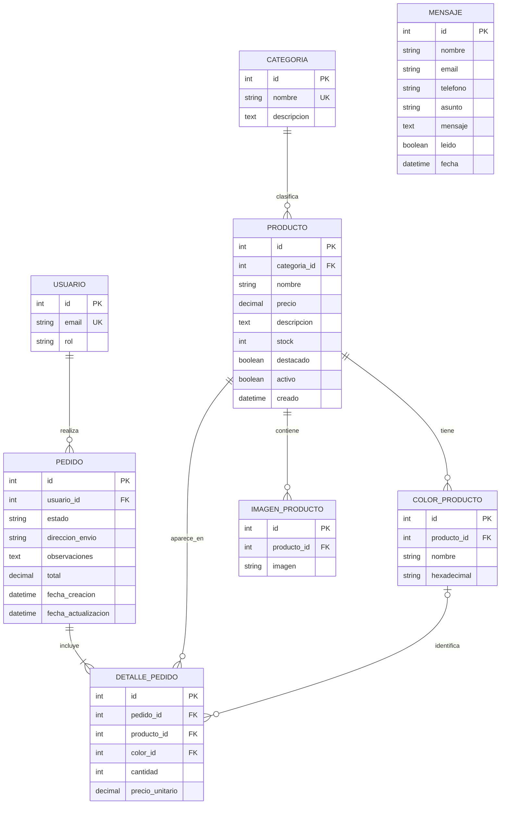

# Modelo Entidad-Relación — Coramanda

## 1. Introducción

El modelo entidad-relación representa la estructura de datos del backend de Coramanda y permite visualizar cómo se relacionan las entidades principales del sistema.

El diseño se implementó utilizando Django ORM y PostgreSQL. Las relaciones se representan mediante claves primarias (PK) y claves foráneas (FK), respetando las necesidades de gestión de usuarios, productos, inventario, pedidos y consultas de contacto.

El modelo contempla ocho entidades: Usuario, Categoria, Producto, ColorProducto, ImagenProducto, Pedido, DetallePedido y Mensaje.

## 2. Diagrama entidad-relación

El siguiente diagrama representa las entidades y sus relaciones:

**Aclaración:** `UK` representa un campo con restricción de unicidad. El campo `color_id` de DetallePedido admite valores nulos porque la selección de color es opcional. Las relaciones del diagrama representan las entidades propias del negocio y no incluyen las tablas internas de autenticación y permisos que Django administra automáticamente.

## 3. Descripción de las entidades

### 3.1. Usuario

Representa a las personas registradas en el sistema.

Se implementa mediante un modelo personalizado basado en `AbstractUser` de Django. Incorpora un correo electrónico único y un campo de rol que permite diferenciar administradores, clientes y visitantes.

La entidad se relaciona con Pedido porque un usuario puede realizar varias compras.

### 3.2. Categoria

Representa las categorías utilizadas para organizar el catálogo.

Contiene un nombre único y una descripción opcional. Una categoría puede contener varios productos, mientras que cada producto pertenece a una categoría.

### 3.3. Producto

Representa los artículos disponibles en el catálogo de Coramanda.

Contiene información como nombre, precio, descripción, stock disponible, estado de actividad y condición de producto destacado.

La clave foránea `categoria_id` permite identificar la categoría a la que pertenece.

El stock se almacena directamente en esta entidad mediante el campo `stock`, ya que cada producto administra su propia cantidad disponible.

### 3.4. ColorProducto

Almacena los colores disponibles para cada producto.

Se relaciona con Producto mediante `producto_id`. Un producto puede tener varios colores y cada color pertenece a un único producto.

Incluye el nombre del color y su código hexadecimal.

### 3.5. ImagenProducto

Almacena las direcciones de las imágenes asociadas a los productos.

Se relaciona con Producto mediante `producto_id`. Un producto puede tener varias imágenes y cada imagen pertenece a un único producto.

### 3.6. Pedido

Representa una compra realizada por un usuario.

Contiene la dirección de envío, observaciones, estado, total y fechas de creación y actualización.

La clave foránea `usuario_id` identifica al usuario que realizó la compra.

### 3.7. DetallePedido

Representa cada línea de productos que integra un pedido.

Se relaciona con Pedido, Producto y, opcionalmente, ColorProducto.

Almacena la cantidad solicitada y el precio unitario registrado al momento de la compra.

Esta entidad permite que un pedido contenga varios productos y que un mismo producto pueda aparecer en distintos pedidos.

También permite conservar el precio histórico de una compra aunque el precio actual del producto cambie.

### 3.8. Mensaje

Almacena las consultas enviadas mediante el formulario de contacto.

Contiene los datos de contacto, asunto, contenido del mensaje, fecha de recepción y estado de lectura.

Es independiente de las demás entidades porque los visitantes pueden enviar consultas sin necesidad de crear una cuenta o realizar un pedido.

## 4. Relaciones y cardinalidades

| Relación | Cardinalidad | Justificación |
|---|---|---|
| Usuario – Pedido | 1 a N | Un usuario puede realizar varios pedidos, pero cada pedido pertenece a un solo usuario. |
| Categoria – Producto | 1 a N | Una categoría puede clasificar varios productos, pero cada producto pertenece a una categoría. |
| Producto – ColorProducto | 1 a N | Un producto puede ofrecer varios colores. |
| Producto – ImagenProducto | 1 a N | Un producto puede tener varias imágenes. |
| Pedido – DetallePedido | 1 a N | Un pedido contiene uno o varios detalles. |
| Producto – DetallePedido | 1 a N | Un producto puede aparecer en distintos detalles de pedidos. |
| ColorProducto – DetallePedido | 1 a N, opcional desde el detalle | Un color puede utilizarse en distintos detalles, mientras que cada detalle puede no tener color o seleccionar uno. |

La entidad Mensaje no tiene relaciones directas con las demás entidades del modelo.

## 5. Justificación del diseño

El diseño responde a los requerimientos funcionales del sistema y permite separar responsabilidades entre las entidades.

**Separación entre Pedido y DetallePedido:** permite representar compras con varios productos y cantidades diferentes. También evita repetir información general del pedido en cada producto incluido.

**Relación entre Producto y Categoria:** permite organizar el catálogo y facilita la consulta de productos por categoría.

**Separación de colores e imágenes:** permite que cada producto tenga múltiples opciones visuales sin duplicar los datos principales del producto.

**Relación entre Usuario y Pedido:** permite identificar al propietario de cada compra y aplicar restricciones de acceso para que los clientes solamente consulten sus propios pedidos.

**Precio histórico en DetallePedido:** permite conservar el precio de compra original, independientemente de las modificaciones posteriores del catálogo.

**Stock dentro de Producto:** evita crear una entidad adicional innecesaria, ya que el inventario se administra directamente mediante el campo `stock`.

**Entidad Mensaje independiente:** permite recibir consultas de cualquier visitante sin exigir autenticación ni vincular el mensaje a una compra.

## 6. Integridad referencial y reglas de eliminación

Las relaciones utilizan claves foráneas y reglas de eliminación definidas en los modelos Django.

- Usuario – Pedido: `PROTECT`, para evitar eliminar usuarios que tengan pedidos asociados.
- Categoria – Producto: `PROTECT`, para evitar eliminar categorías utilizadas por productos.
- Producto – ColorProducto: `CASCADE`, para eliminar los colores asociados cuando se elimina un producto.
- Producto – ImagenProducto: `CASCADE`, para eliminar las imágenes asociadas cuando se elimina un producto.
- Pedido – DetallePedido: `CASCADE`, para eliminar los detalles cuando se elimina un pedido.
- Producto – DetallePedido: `PROTECT`, para conservar la integridad de los pedidos históricos.
- ColorProducto – DetallePedido: `PROTECT`, para evitar eliminar colores que estén asociados a detalles de pedidos.

Además, DetallePedido posee una restricción de unicidad sobre la combinación de pedido, producto y color. Esto impide repetir una misma combinación dentro de un pedido.

## 7. Conclusión

El modelo entidad-relación permite organizar la información de Coramanda de manera consistente y facilita la comunicación entre los módulos de usuarios, productos, stock, pedidos y contacto.

La utilización de claves foráneas, restricciones de unicidad y reglas de eliminación contribuye a mantener la integridad de los datos.

La estructura también permite ampliar el sistema en el futuro sin necesidad de duplicar información ni mezclar responsabilidades entre entidades.